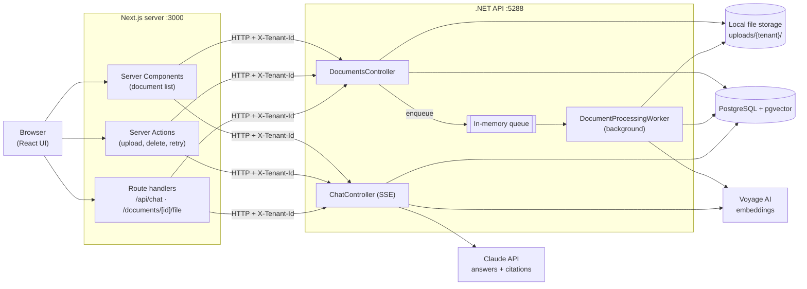
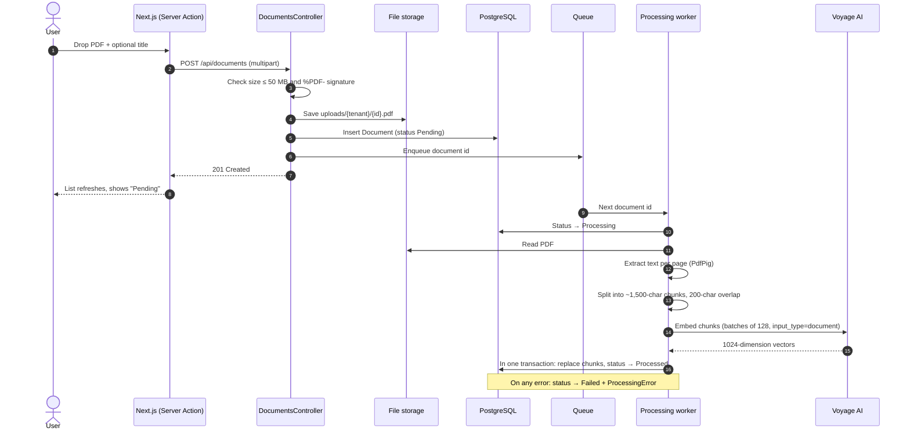
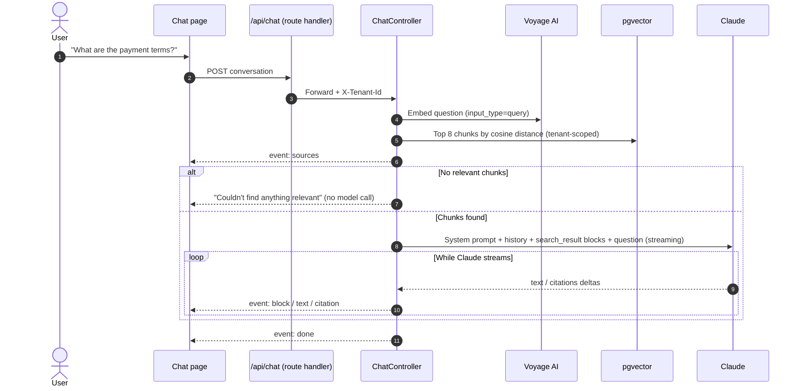
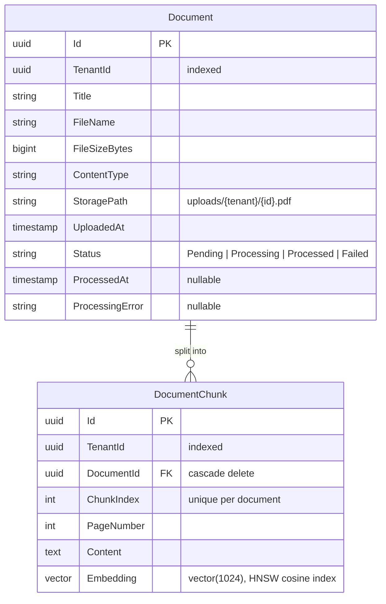

# DocuMind AI

DocuMind AI is a multi-tenant B2B SaaS platform for working with large collections of business documents. Companies upload PDFs such as contracts, compliance records and technical manuals. DocuMind extracts their text, indexes it for semantic (vector) search, and lets people ask questions in plain language. Answers come from Claude and cite the exact document and page they're based on.

> **Status:** early development. Uploading, processing, vector search and question answering with citations work end to end. Sign-in, compliance audits and production deployment are not built yet (see the [Roadmap](#roadmap)).

---

## Contents

- [What it does](#what-it-does)
- [Technology stack](#technology-stack)
- [Architecture](#architecture)
  - [System overview](#system-overview)
  - [Document ingestion pipeline](#document-ingestion-pipeline)
  - [Question answering (RAG)](#question-answering-rag)
  - [Multi-tenancy](#multi-tenancy)
  - [Data model](#data-model)
  - [Key design decisions](#key-design-decisions)
- [Repository structure](#repository-structure)
- [Getting started](#getting-started)
- [Configuration](#configuration)
- [API reference](#api-reference)
- [Development workflow](#development-workflow)
- [Known limitations](#known-limitations)
- [Roadmap](#roadmap)

---

## What it does

| Feature | Description |
|---|---|
| **Upload** | Drag and drop PDFs up to 50 MB. Files are checked by their content (not just their name) and stored per tenant. |
| **Automatic processing** | A background worker extracts text page by page, splits it into overlapping chunks, and creates a vector embedding for each chunk with Voyage AI. |
| **Live status** | Each document shows *Pending → Processing → Processed* (or *Failed*, with the reason and a Retry button). The list refreshes itself while work is in progress. |
| **Ask your documents** | Ask a question in plain language. The most relevant chunks are found by vector similarity and sent to Claude, which answers only from them. |
| **Citations** | Every claim in an answer is marked with a citation like **[1]**. Clicking it opens the source PDF at the cited page. |
| **Tenant isolation** | Every document, chunk and search is scoped to one tenant (company), and the database layer enforces this automatically. |

---

## Technology stack

### Frontend: `src/frontend`

| Technology | Version | Role |
|---|---|---|
| [Next.js](https://nextjs.org) (App Router) | 16.2 | Web framework: server-rendered pages, Server Actions, route handlers |
| [React](https://react.dev) | 19.2 | UI components (`useActionState`, `useTransition`) |
| [TypeScript](https://www.typescriptlang.org) | 5 | Type safety |
| [Tailwind CSS](https://tailwindcss.com) | 4 | Styling, including dark mode |
| [`server-only`](https://www.npmjs.com/package/server-only) | — | Guarantees API-client code never ships to the browser |

### Backend: `src/Backend/DocuMind.Api`

| Technology | Version | Role |
|---|---|---|
| [ASP.NET Core](https://learn.microsoft.com/aspnet/core) | .NET 10 | REST API, server-sent events, background worker |
| [Entity Framework Core](https://learn.microsoft.com/ef/core) + [Npgsql](https://www.npgsql.org/efcore/) | 10 | Database access and migrations |
| [Pgvector.EntityFrameworkCore](https://github.com/pgvector/pgvector-dotnet) | 0.3 | `vector` column type and cosine-distance queries |
| [PdfPig](https://github.com/UglyToad/PdfPig) | 0.1.16 | PDF text extraction |
| [Anthropic C# SDK](https://github.com/anthropics/anthropic-sdk-csharp) | 12.58 | Claude Messages API (streaming, citations) |
| [Microsoft.Extensions.Http.Resilience](https://learn.microsoft.com/dotnet/core/resilience/http-resilience) | 10.11 | Retries with backoff, timeouts and a circuit breaker for Voyage calls |
| [Scalar](https://github.com/scalar/scalar) + built-in OpenAPI | — | Interactive API reference at `/scalar/v1` (development only) |

### Data and AI services

| Service | Role |
|---|---|
| **PostgreSQL 17 + [pgvector](https://github.com/pgvector/pgvector)** | Relational data, plus vector storage with an HNSW index for fast similarity search. Runs in Docker (`pgvector/pgvector:pg17`). |
| **[Voyage AI](https://www.voyageai.com)** (`voyage-4`, 1024 dimensions) | Turns text chunks and questions into embeddings. Documents and questions use different `input_type` settings (`document` and `query`) for better retrieval. |
| **[Claude](https://www.anthropic.com/claude)** (`claude-opus-5-5`) | Writes the answers. Chunks are sent as *search result* blocks with citations enabled, so Claude's answer references them directly. |

---

## Architecture

### System overview



The system has three parts:

1. **Next.js (backend-for-frontend).** The browser only talks to the Next.js server. Next.js renders the document list on the server, handles uploads and deletes through **Server Actions**, and forwards the chat and download streams through **route handlers**. The .NET API's address and the tenant header stay on the server, which is also where user access tokens will go once sign-in exists.
2. **The .NET API.** Holds all business logic: validation, storage, the processing pipeline, retrieval and the Claude integration. It is the only component that touches the database, the files and the AI services.
3. **PostgreSQL with pgvector.** One database holds both the relational data (documents, status) and the vectors (chunk embeddings). No separate vector database is needed.

### Document ingestion pipeline



How chunking works ([`TextChunker`](src/Backend/DocuMind.Api/Processing/TextChunker.cs)):
- **Chunks never cross pages**, so every chunk has an exact page number for citations.
- **Size:** about 1,500 characters (roughly 350–400 tokens), small enough for precise retrieval but large enough to keep a clause together.
- **Break points:** a paragraph break if possible, then a sentence end, then a word boundary.
- **Overlap:** 200 characters, so a sentence split across two chunks still appears whole in one of them.

The pipeline is built to recover from failures:
- **Retries:** Voyage calls are retried on rate limits (429) and server errors with exponential backoff and jitter.
- **Restarts:** the queue lives in memory, so on startup the worker re-queues every document still `Pending` or `Processing`.
- **Reprocessing:** a document can be processed again (`POST /api/documents/{id}/reprocess`). Old chunks are swapped for new ones in a single transaction, so a document is never left half-indexed.

### Question answering (RAG)

DocuMind uses **Retrieval-Augmented Generation (RAG)**: rather than trusting the model's general knowledge, it first *retrieves* the relevant passages from your documents and asks Claude to answer *only* from them.



How it works in detail ([`ChatService`](src/Backend/DocuMind.Api/Chat/ChatService.cs)):
- **Retrieval:** the question is embedded with Voyage, and pgvector returns the 8 chunks with the smallest cosine distance. An HNSW index keeps this fast. Only `Processed` documents of the current tenant are searched, and searches can optionally be limited to specific documents.
- **Grounding:** each chunk is sent to Claude as a [`search_result`](https://platform.claude.com/docs/en/build-with-claude/search-results) content block whose title names the document and page, with citations enabled. The system prompt tells Claude to answer only from those results, to say when the documents don't cover the question, and to point out conflicts between sources.
- **Citations:** Claude's response arrives as text blocks, each carrying the search results that support it. The API streams these to the browser as server-sent events:

  | Event | Meaning |
  |---|---|
  | `sources` | The retrieved chunks |
  | `block` | A new text span starts |
  | `text` | More text for the current span |
  | `citation` | A source supporting the current span |
  | `done` | The answer is complete |
  | `error` | Something failed |

  The UI turns these into inline **[n]** markers and a source list.
- **Safety and cost:**
  - Refusal fallback is on (`fallbacks: "default"`): if Claude's safety classifiers decline a request, it is re-run on Anthropic's recommended fallback model.
  - Effort is set explicitly to `medium`.
  - If retrieval finds nothing, Claude is not called at all.

### Multi-tenancy

Each company is a **tenant**, identified by a `TenantId` (GUID) on every `Document` and `DocumentChunk`.

- **Query filter:** [`ApplicationDbContext`](src/Backend/DocuMind.Api/Data/ApplicationDbContext.cs) applies an EF Core **global query filter** (`TenantId == current tenant`) to both tables. Every query is scoped automatically, so forgetting a `Where` clause cannot leak another tenant's data.
- **Background work:** the processing worker runs outside any request. It deliberately bypasses the filter (`IgnoreQueryFilters`) and copies the document's `TenantId` onto each chunk itself.
- **Files:** stored under `uploads/{tenantId}/`, and the storage layer refuses any path outside its root (path traversal protection).
- **Current tenant (temporary):** for now the tenant comes from an `X-Tenant-Id` header that the Next.js server adds, with a fixed development tenant as fallback ([`HeaderTenantProvider`](src/Backend/DocuMind.Api/Tenancy/HeaderTenantProvider.cs)). Once sign-in is added, it will come from the signed-in user's token instead. Nothing else needs to change, because everything depends on the `ITenantProvider` interface.

### Data model



Schema changes are managed with EF Core migrations in [`Migrations/`](src/Backend/DocuMind.Api/Migrations).

### Key design decisions

| Decision | Why |
|---|---|
| **Next.js server calls the API, not the browser** | Keeps the API address, tenant header and (later) access tokens off the client. No CORS is needed in production. |
| **pgvector instead of a separate vector database** | One database to run, back up and secure. Vectors and their documents stay consistent through transactions. |
| **Chunks never cross page boundaries** | Every citation can point to an exact page. |
| **Claude search-result blocks with citations** | Citations are produced by the API itself and tied to the exact chunk, so they don't depend on the model formatting references correctly. |
| **Background worker with an in-memory queue** | Uploads return immediately and processing happens afterwards. This is simple for one API instance; the queue is behind an interface so a message broker can replace it later. |
| **Storage behind `IFileStorage`** | Local disk for development; S3 or Azure Blob Storage can be swapped in without touching the controllers. |
| **Secrets in .NET user-secrets and `.env` files** | No passwords or API keys in git. |

---

## Repository structure

```
documind-ai/
├── docker-compose.yml            # PostgreSQL 17 + pgvector
├── .env.example                  # Template for database credentials (copy to .env)
└── src/
    ├── Backend/
    │   ├── DocuMind.slnx
    │   └── DocuMind.Api/
    │       ├── Program.cs                # Composition root: DI, middleware, configuration
    │       ├── Controllers/
    │       │   ├── DocumentsController.cs  # Upload, list, download, reprocess, delete
    │       │   └── ChatController.cs       # POST /api/chat → server-sent events
    │       ├── Chat/                     # Retrieval (pgvector) + Claude answer streaming
    │       ├── Processing/               # PDF extraction, chunking, queue, background worker
    │       ├── Embeddings/               # Voyage AI client (IEmbeddingService)
    │       ├── Storage/                  # IFileStorage + local disk implementation
    │       ├── Tenancy/                  # ITenantProvider (header-based for now)
    │       ├── Data/                     # ApplicationDbContext, query filters, indexes
    │       ├── Entities/                 # Document, DocumentChunk
    │       ├── Contracts/                # API response shapes
    │       ├── Migrations/               # EF Core migrations
    │       └── DocuMind.Api.http         # Ready-made requests for VS Code / Rider
    └── frontend/
        ├── next.config.ts                # Server Action body limit (51 MB)
        ├── .env.example                  # API URL + development tenant id
        └── src/
            ├── lib/
            │   ├── api.ts                # Server-only client for the .NET API
            │   ├── documents.ts          # Shared types and limits
            │   └── chat.ts               # Chat types + SSE stream parser
            └── app/
                ├── layout.tsx, site-header.tsx
                ├── page.tsx              # Documents: upload form + list
                ├── actions.ts            # Server Actions: upload, delete, reprocess
                ├── chat/                 # "Ask" page and chat UI
                ├── api/chat/route.ts     # Streams chat events from the API
                └── documents/[id]/file/route.ts  # PDF download/inline view
```

---

## Getting started

### Prerequisites

| Tool | Notes |
|---|---|
| [.NET SDK 10](https://dotnet.microsoft.com/download) | `dotnet --version` should print `10.x` |
| [Node.js 20.9+](https://nodejs.org) | Required by Next.js 16 |
| Docker | Docker Desktop, or the lighter Docker Engine inside WSL2 on Windows |
| `dotnet-ef` | `dotnet tool install --global dotnet-ef` |
| API keys | A [Voyage AI](https://dashboard.voyageai.com) key and an [Anthropic](https://platform.claude.com) key |

### 1. Start the database

```bash
cp .env.example .env               # then set a strong POSTGRES_PASSWORD
docker compose up -d               # on Windows with WSL: wsl -e docker compose up -d
```

### 2. Configure and run the API

```bash
cd src/Backend/DocuMind.Api
dotnet user-secrets set "ConnectionStrings:DefaultConnection" "Host=localhost;Port=5432;Database=documind;Username=postgres;Password=<same as .env>"
dotnet user-secrets set "Voyage:ApiKey" "<your Voyage key>"
dotnet user-secrets set "Anthropic:ApiKey" "<your Anthropic key>"

dotnet ef database update          # creates tables, indexes and the vector extension
dotnet run                         # http://localhost:5288 (API reference: /scalar/v1)
```

### 3. Run the frontend

```bash
cd src/frontend
cp .env.example .env.local
npm install
npm run dev                        # http://localhost:3000
```

Open <http://localhost:3000>, upload a PDF, wait for it to show **Processed**, then ask a question on the **Ask** page.

---

## Configuration

### Backend (`appsettings.json`, overridable through user-secrets or environment variables)

| Key | Default | Description |
|---|---|---|
| `ConnectionStrings:DefaultConnection` | — | PostgreSQL connection string (keep in user-secrets) |
| `Storage:RootPath` | `uploads` | Folder for uploaded files, relative to the API project |
| `Voyage:ApiKey` | — | Voyage AI key (**secret**) |
| `Voyage:Model` | `voyage-4` | Embedding model |
| `Voyage:BatchSize` | `128` | Chunks per embedding request |
| `Anthropic:ApiKey` | — | Anthropic key (**secret**). Falls back to the `ANTHROPIC_API_KEY` environment variable |
| `Anthropic:Model` | `claude-opus-5-5` | Model used for answers |
| `Anthropic:Effort` | `medium` | How much effort Claude spends per answer (`low` … `max`) |
| `Anthropic:RetrievalLimit` | `8` | Chunks retrieved per question |
| `Cors:AllowedOrigins` | `http://localhost:3000` (dev) | Origins allowed to call the API directly |
| `Tenancy:DevelopmentTenantId` | `…0001` (dev) | Tenant used when no `X-Tenant-Id` header is sent |

Environment variables use `__` in place of `:`, for example `Anthropic__Model=claude-sonnet-5-5`.

> **Important:** the embedding size (1024) is fixed by the `vector(1024)` column. If you change `Voyage:Model` to one with a different size, add a migration and reprocess all documents.

### Frontend (`src/frontend/.env.local`)

| Variable | Description |
|---|---|
| `DOCUMIND_API_URL` | Base URL of the .NET API (server-side only) |
| `DOCUMIND_TENANT_ID` | Tenant sent as `X-Tenant-Id` until sign-in exists |

### Database (`.env` next to `docker-compose.yml`)

`POSTGRES_USER`, `POSTGRES_PASSWORD`, `POSTGRES_DB`.

---

## API reference

All endpoints are scoped to the current tenant. The interactive reference is at `http://localhost:5288/scalar/v1` while running in development.

| Method | Path | Description |
|---|---|---|
| `GET` | `/api/documents` | List documents, newest first |
| `GET` | `/api/documents/{id}` | Get one document's details and status |
| `GET` | `/api/documents/{id}/file` | Download the original PDF |
| `POST` | `/api/documents` | Upload a PDF (`multipart/form-data`: `file`, optional `title`). Returns `201` and queues processing |
| `POST` | `/api/documents/{id}/reprocess` | Queue a document again. Returns `202`, or `409` if it is already queued |
| `DELETE` | `/api/documents/{id}` | Delete the document, its chunks and its file |
| `POST` | `/api/chat` | Ask a question. Body: `{ "messages": [{ "role": "user", "content": "…" }], "documentIds"?: [...] }`. Response: a `text/event-stream` |

Errors use the standard [Problem Details](https://www.rfc-editor.org/rfc/rfc9457) JSON format. Example requests for every endpoint are in [`DocuMind.Api.http`](src/Backend/DocuMind.Api/DocuMind.Api.http).

---

## Development workflow

| Task | Command |
|---|---|
| Build the API | `dotnet build` (in `src/Backend`) |
| Add a migration | `dotnet ef migrations add <Name>` (in `src/Backend/DocuMind.Api`) |
| Apply migrations | `dotnet ef database update` |
| Lint the frontend | `npx eslint .` (in `src/frontend`) |
| Production build of the frontend | `npm run build` |
| Inspect the database | `docker exec -it documind_db psql -U postgres -d documind` |

Branches: work happens on feature branches (for example `feature/document-upload`) and is merged into `main` through pull requests.

---

## Known limitations

- **No sign-in yet:** the tenant comes from a header and a development fallback. Don't expose the API publicly in this state.
- **Scanned PDFs:** image-only PDFs contain no extractable text and are marked *Failed*. OCR is not supported yet.
- **One API instance:** the in-memory processing queue doesn't survive across multiple instances; a message broker is needed to scale out.
- **Chats aren't saved:** conversations disappear on page refresh, and only the latest question is used for retrieval.
- **Formatting:** answers render as plain text, so Markdown formatting isn't shown as formatting yet.
- **Local file storage:** fine for development; production needs cloud storage (S3 or Azure Blob).

---

## Roadmap

- [x] Project setup: Next.js 16 frontend, .NET 10 API, PostgreSQL + pgvector in Docker
- [x] Document upload, listing, download and deletion with tenant scoping
- [x] Processing pipeline: PDF text extraction, chunking, Voyage embeddings, background worker
- [x] Question answering with Claude, streaming and page-level citations
- [ ] **Compliance and risk audits:** run configurable checklists (for example "has an indemnity clause", "termination notice ≥ 60 days") against each document with Claude and store the findings
- [ ] **Sign-in and real tenants:** organizations, users and roles; tenant taken from the signed-in user's token
- [ ] Saved chat history and Markdown rendering
- [ ] OCR for scanned PDFs
- [ ] Cloud file storage and a durable job queue
- [ ] Tests, CI/CD, containerized deployment and observability
